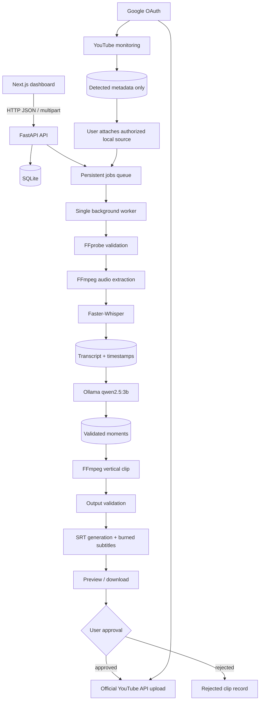

# Automation architecture

## End-to-end architecture



The YouTube monitoring branch never downloads public videos. It stores metadata until the user supplies an authorized local source file.

## Current queue

The SQLite `jobs` table is the durable queue. Jobs include status, progress, attempts, payload, timestamps, errors, cancellation requests, and a deduplication key.

The opt-in `JobWorker` polls one pending job at a time. It recovers jobs left in `processing` after a restart and supports transcription, analysis, and complete `pipeline` jobs. Set `ENABLE_BACKGROUND_WORKER=true` only after local testing.

```text
API → jobs(pending) → single worker claims job → processing → completed/failed/cancelled
                         ↘ restart recovery → pending

For an uploaded authorized video, the API creates one deduplicated `pipeline` job. The worker records stage and progress as it reuses or executes transcription, Qwen analysis, clip extraction, subtitle generation, subtitle burning, and output validation.
```

Endpoints:

- `GET /api/jobs`
- `GET /api/jobs/{job_id}`
- `POST /api/jobs` (`transcription`, `analysis`, or `pipeline`)
- `POST /api/jobs/{job_id}/retry`
- `POST /api/jobs/{job_id}/cancel`

## Resource policy

The worker is intentionally single-concurrency for a Ryzen 3 / 16 GB CPU laptop. Faster-Whisper and Qwen should not be run concurrently with another heavy video job.

## YouTube monitoring

Monitoring uses the official YouTube Data API uploads playlist. It stores channel/video metadata only. The scheduler is disabled by default and starts only when both `ENABLE_BACKGROUND_WORKER=true` and `YOUTUBE_MONITORING_ENABLED=true`. A detected public video remains `awaiting_authorized_source` until the user uploads a local file they own or are authorized to process.

Monitoring endpoints:

- `POST /api/youtube/channels`
- `GET /api/youtube/channels`
- `PATCH /api/youtube/channels/{channel_id}/monitoring`
- `POST /api/youtube/monitor/run`
- `GET /api/youtube/detected-videos`
- `POST /api/youtube/detected-videos/{id}/source`
- `POST /api/youtube/detected-videos/{id}/process`

## Cancellation and retry behavior

Cancellation is cooperative and occurs at safe stage boundaries; a running Faster-Whisper or FFmpeg subprocess is not force-killed. Failed jobs retain completed database outputs and can be retried through the job endpoint or dashboard. Existing transcripts, moments, clips, and subtitle files are reused where possible to prevent duplicate processing.

## Current limitation

The worker remains opt-in and single-concurrency. Real local-video execution of the complete worker pipeline still depends on the available Faster-Whisper model and Ollama service at runtime.
